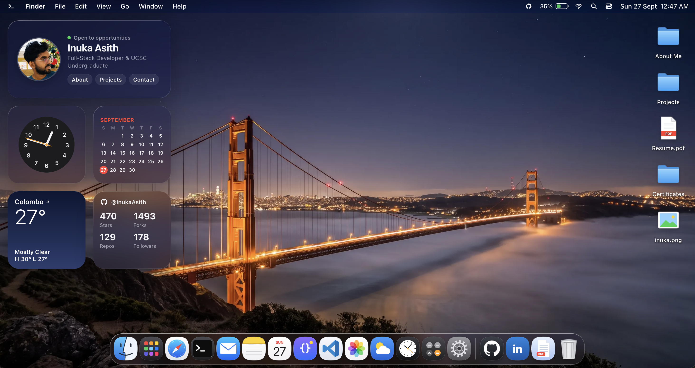
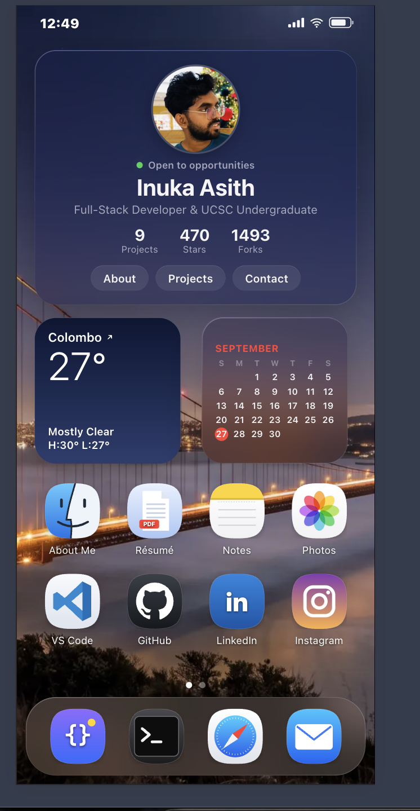

# Portfolio (Macos27)





A macOS 26–style desktop portfolio: a Liquid Glass lock screen, then a desktop with working apps.

- **Apps:** Terminal (zsh, `help`, `neofetch`, `cmatrix`, `sl`…), Finder, Safari (tabs, real browsing), Projects, Mail, Notes, VS Code, Photos, Calculator, System Settings, Preview (résumé).
- **System:** draggable/resizable windows, minimize to Dock, Dock magnification, Spotlight (⌘K / Ctrl+K), Launchpad (F4), Control Center, notifications, light/dark, wallpapers, live weather + GitHub stats.

## Deploy (Vercel)

One command from this folder (first run asks you to log in and link a project):

```bash
npm run deploy        # = npx vercel --prod
```

Or push the folder to GitHub and click **Import** on vercel.com: `vercel.json` already sets the Vite build, the `dist` output, the `api/proxy.js` function and cache headers, so no settings need changing.

## Develop

```bash
npm install
npm run dev      # http://localhost:5173
npm run build
```
